<div align="center">

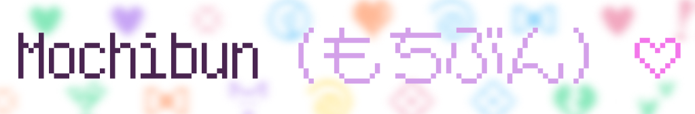

A lightweight pastel Android launcher built from scratch for physical keypad and D-pad flip phones ♡<br/>
Lovingly tuned for the **ALT Mive Style Folder (AT-M120)**.

[Download Latest APK](https://github.com/smolstinkyprincess/Mochibun/releases/latest) • [Setup](#-downloads--setup) • [Screenshots](#-gallery--showcase-) • [Keypad Guide](#️-physical-key-map)

</div>

---

> ♡ **Quick heads up:** No root needed! As of **v2.1.0**, Mochibun runs happily on a stock, unrooted flip phone: launcher, T9 search, Keitai keyboard, Kaomoji wheel, themes, and even the side-key mouse pointer (through an optional Accessibility helper). Root-only settings stay tucked away until you ask for them. Rooted with Magisk + LSPosed? The extra magic wakes up: pastel SystemUI theming, speedy native taps, key remapping in every app, and the new **Lid LED Studio ✨** for the outer lid lights. Full steps are in [Setup](#-downloads--setup).

---

## ✨ Features

### Everyday
- **Made for real buttons**: Everything works with the d-pad, and a soft pastel glow shows what's selected so you never lose your place.
- **Keitai keyboard**: A system-wide multi-tap keypad keyboard in a little floating pill. Tap a number to cycle its letters, hold for the digit, `*` for shift, `#` for space. It hops out of the way of what you're typing in.
- **Kaomoji wheel**: Long-press `#` in any app to pop up a wheel of text faces and paste one into your chat `( ˶ˆᗜˆ˵ ) ♡`
- **Widgets & music deck**: A widget page with a Now Playing card that appears when music plays and hides when it stops. Third-party widgets work too.
- **Virtual mouse pointer**: Press the side key (F4) for a little cursor in touch-only apps. Click with the center key, scroll with `2`/`8` and `4`/`6`, and use your own `.png` or `.gif` sprite. No root? Turn on the optional Accessibility helper and it taps and scrolls anyway.
- **Clamshell tricks**: Choose what opens when you flip the phone open (Home, Resume Last App, or Notifications), plus an optional snap sound when you close it. **Screen-Off Flip Reset** tidies up (back to Home, menus closed, cursor hidden) whenever the screen goes dark, so unrooted phones get a clean flip-shut too.
- **Soft-key navigation**: Recents and Back act as little LSK / RSK soft keys on Home and in the drawer, and you can switch that off in *Settings > Virtual Cursor*.
- **Offline & private**: No internet permission, no camera permission, no telemetry.

### Make it yours
- **5 pastel themes**: *Sakura Dream*, *Lavender Mist*, *Minty Matcha*, *Milky Peach*, and *Midnight Mochi* for night owls 🌙. Switch live, or write your own in simple YAML.
- **7 keypad sound profiles**: Generated on-device, so the app stays tiny. Pick *Kawaii Pop*, *Retro Keitai*, *8-Bit Chiptune*, *Cyber Pager*, *Tactile Thock*, *Water Drop*, or *Muted* for library mode.
- **Share your setup**: Back up pinned apps, folders, and settings to `.json`, or pack colors, cursor, and wallpaper into a `.mochibun` bundle to swap with friends.
- **Icon pack support**: Works with Nova, Apex, and ADW icon packs.

### Root / LSPosed extras
- **Key remapping**: Remap extra physical buttons to launch apps or shortcuts, in every app, with no accessibility service running.
- **QuickSwitch recents**: Make Mochibun's keypad recents switcher your system Recents provider.
- **In-place toggles**: Wi-Fi and Bluetooth flip right inside the Quick Settings card (without root, they open the Android settings panel instead).
- **Speedy root clicks**: The cursor taps through a tiny native helper, even on screens that ignore normal taps.
- **Media volume lock**: The volume rocker always changes *media* volume, even in Silent Mode.
- **Pastel SystemUI**: Your palette also colors Quick Settings, the volume dialog, notification cards, and the status and nav bars.
- **Lid LED pulses**: Notification shimmers and a charging glow on the outer lid lights, in the color you pick.
- **Lid LED Studio ✨**: Draw your own little light shows for the five windows on the outer lid! Build them step by step (500 ms per step, up to 16 steps) with 7 vivid keitai swatches, preview them on screen, then hit **Test Lid ♡** to watch them play for real. Pick one animation for **notifications** and another for **charging**: each loops for about a minute, then rests on its last frame. Comes with 5 cute presets (*Sakura Chase ♡*, *Keitai Rainbow*, *Mint Heartbeat*, *Berry Sparkle*, *Lemon Ping-Pong*), and you can share them as `.mochibunled` files  to trade with friends. Find it in *Settings > Behavior*.

---

## 📸 Gallery & Showcase ♡

<div align="center">

| 🌸 Home Screen | 🍡 App Drawer | 🗂️ Recents | 🎀 Folders |
| :---: | :---: | :---: | :---: |
| 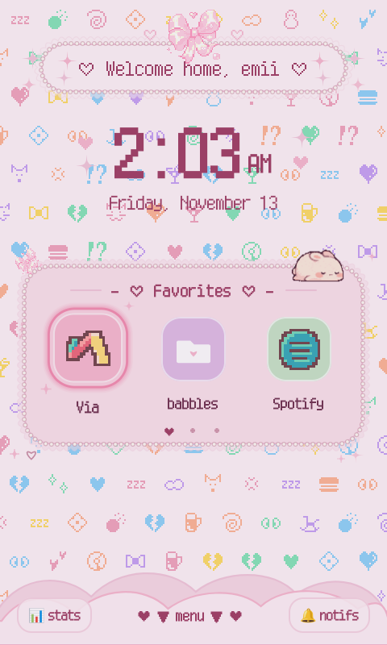 | 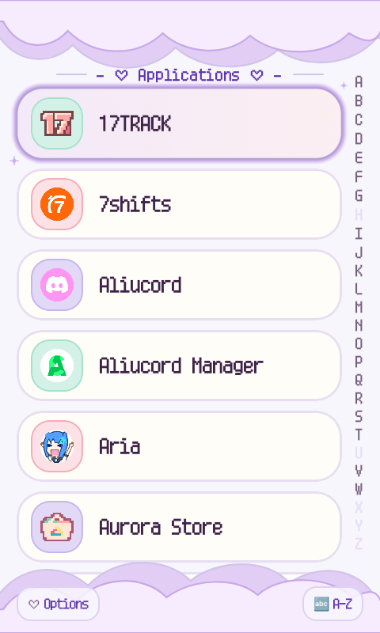 | 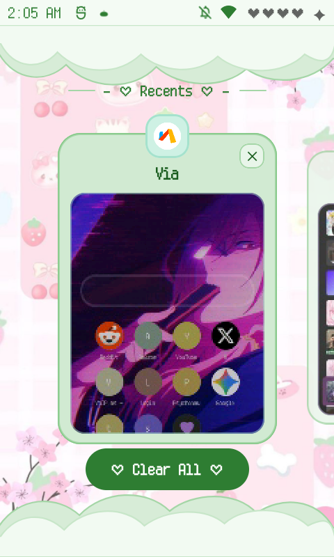 | 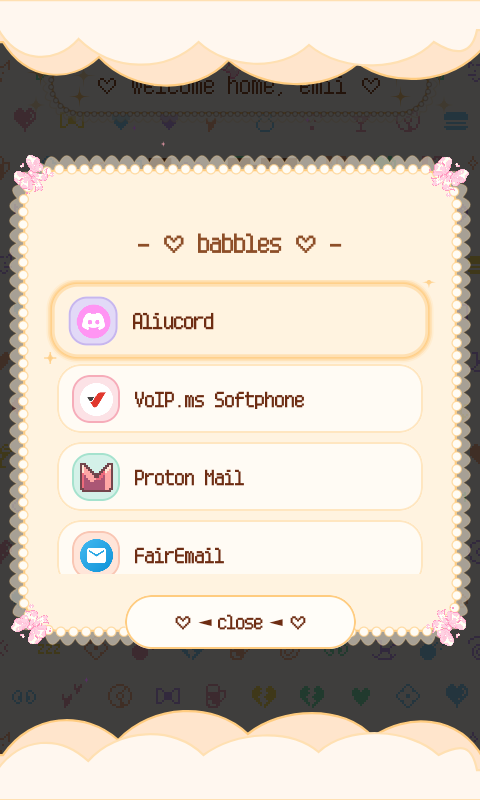 |

| 📊 System Stats | 💌 Notifications | 🌸 Kaomoji Wheel | ⚙️ Settings Hub |
| :---: | :---: | :---: | :---: |
| 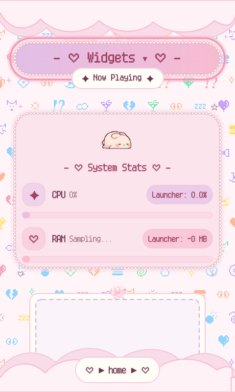 | 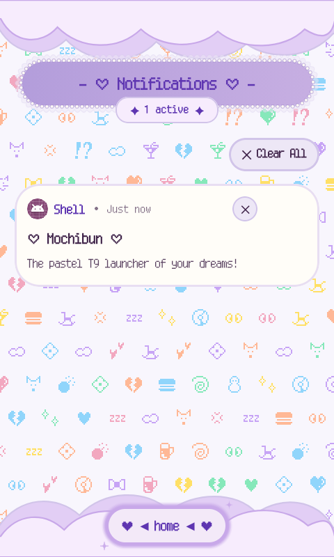 | 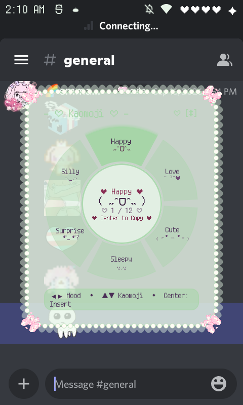 | 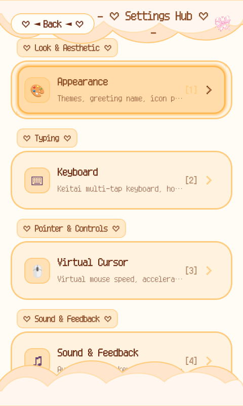 |

| ✨ Lid LED Studio | 💡 Step Maker | 🎨 Pastel SystemUI |
| :---: | :---: | :---: |
| 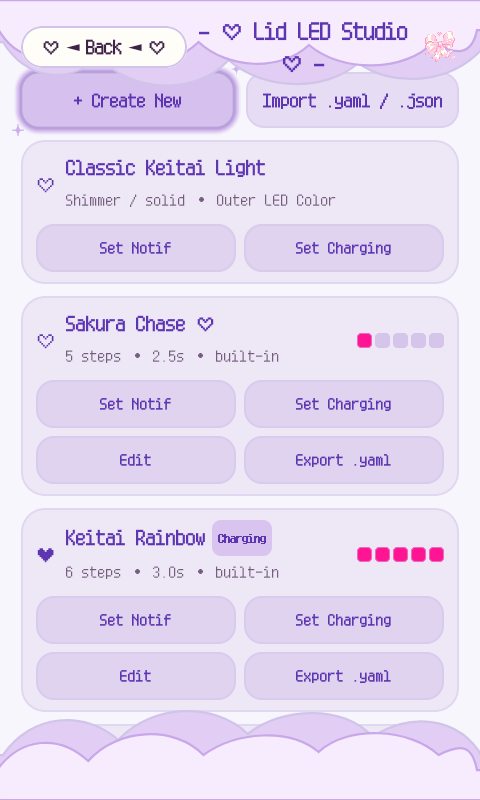 | 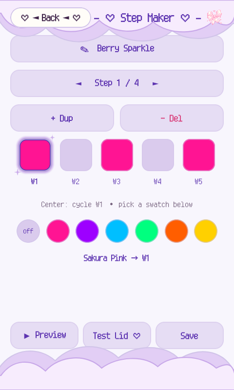 | 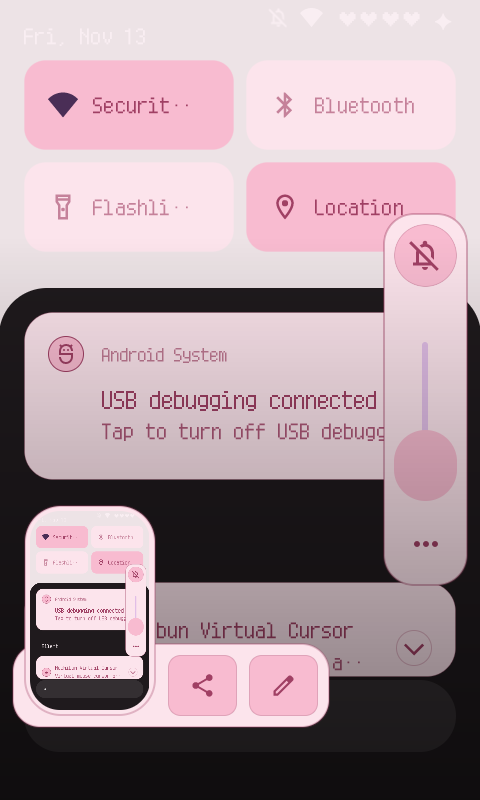 |

</div>

---

## ⌨️ Physical Key Map

| Button | Click | Hold (~400 ms) |
| :--- | :--- | :--- |
| **Physical Arrows** | Move around cards, drawers & wheel wedges | Fast-scroll |
| **Center Key** | Open app, select item, or click | Quick menu (pin, edit icon, app info) |
| **`#` (Pound)** | Open settings & theme switcher | **Kaomoji Wheel 🌸** |
| **`*` (Star)** | Context actions | Toggle silent / vibrate |
| **`0`** | Jump to top / input | **Flashlight 🔦** (on Home) |
| **`2`–`9`** | T9 search (in drawer) | **Speed dial** |
| *(while typing)* | See the [Keitai Keyboard](#-mochibun-keitai-keyboard) keys | — |
| **Side Key (F4)** | Mouse pointer on / off | Dismiss popup / dialog |
| **Call Key** | Phone dialer | — |
| **Back** | Close dialogs, folders, or drawer & return Home | — |
| **Home** | Return Home from anywhere; on Home, open the app drawer | — |
| **Recents (LSK)** | On Home, go to the Stats page | On Home, open Recents |

> 🗝️ Without root, the side key and cursor keys work everywhere through the optional [Accessibility helper](#-standard-non-root-setup). Remapping extra buttons in every app comes from the [LSPosed module](#-lsposed-module-hardware-keys--cursor).

---

## 🔤 Mochibun Keitai Keyboard

Mochibun ships its own keypad keyboard, so typing feels like a real 2000s keitai, in any app on the phone:

| Key | Tap | Hold |
| :--- | :--- | :--- |
| **`2`–`9`** | Cycle through the key's letters | Type the digit |
| **`*`** | Shift: `abc` → `Abc` → `ABC` | — |
| **`#`** | Space | **Kaomoji Wheel 🌸** |
| **Left / Right** | Pick a different letter in the candidate strip | — |
| **Center** | Commit the current letter (or send / go when nothing is pending) | — |
| **Up / Down** | Commit the letter and move on | — |
| **Back / Delete** | Cancel the pending letter, or delete | — |

- The keyboard is a little floating pill, so it never squishes the app behind it. When you're not pressing keys, it shrinks down to a tiny `abc` / `Abc` / `ABC` badge.
- **It dodges your text box.** If the box you're typing in is down at the bottom of the screen (hi, Discord), the pill hops to the top so you can see your words, then hops back down when the coast is clear. Some apps don't tell Android where the cursor is, and in those the pill just stays at the bottom.
- **It fades when you pause.** After a moment with no key presses the pill turns soft and see-through, then comes back to full strength on your next press.
- A pending letter commits on its own after a short pause (**T9 Auto-Commit Delay**: 0.7 s by default, adjustable from 0.3 to 1.5 s), so you can just keep typing.
- Sentences auto-capitalize.
- Number, phone, and date fields get plain digits, so dialing works the way you'd expect.
- Works in terminals like **Termux** too. Delete and Enter go straight to the terminal as plain keys.
- Tune the **hold delay** (250–800 ms), **letter auto-commit** timer, and **hold vibration** under **Settings > Keyboard**. Both are saved in your backups.

**Setup**: Open **Settings > Keyboard** and follow the steps there, or go to *Settings > System > Languages & input > On-screen keyboard* and enable **Mochibun Keitai IME**.

---

## 🌸 Kaomoji Wheel (`#` Long-Press)

Never wrestle with tiny touch keyboards just to send a cute face:

1. **Pop it open**: Hold **`#`** for a split second, anywhere on the phone, even mid-chat in another app.
2. **Pick a mood**: Press the **left / right arrows** (or keys **`1`–`6`**) to spin through *Happy*, *Love*, *Cute*, *Sleepy*, *Surprised*, or *Silly*.
3. **Pick a face**: Press the **up / down arrows** to browse the kaomojis in the middle.
4. **Send it**: Click the **center key** and your face pops right into the text box you were typing in.
5. **Close**: Tap **Back**, your side key, or **`#`** again to tuck it away.

---

## 🎨 Themes & Custom Styling

### 🎀 Shareable Theme Packs (`.mochibun`)
Want to show off your setup on r/flipphones or Discord? Export a `.mochibun` bundle to pack up your colors, greeting text, wallpaper, and custom mouse cursor (`.gif`/`.png`). Opening a `.mochibun` file on your phone shows a live color swatch card, and it applies in one click!

### 📝 Hand-Crafted YAML Themes (`kaml`)
Writing JSON on a flip-phone keypad is nobody's idea of a good time. Mochibun uses clean, readable YAML for custom themes—drop your `.yaml` files into `/sdcard/Android/data/one.crinklecod.mochibun/files/themes/`:

```yaml
# /sdcard/Android/data/one.crinklecod.mochibun/files/themes/sweet_sakura.yaml
id: "sweet_sakura"
name: "Sweet Sakura ♡"
author: "emii"
version: "1.0"

colors:
  primary: "#FFB7C5"
  container: "#FFF0F5"
  cardBorder: "#F3D1DC"
  accentDeep: "#8B3A62"
  background: "#FFF5F8"
  outline: "#F8BBD0"
  selectionGlow: "#FF8DA1"
  textColor: "#4A154B"

decorations:
  greetingText: "— ♡ Sweet Sakura ♡ —"
  glowExpansionDp: 4.0
  cardRoundnessDp: 24.0
```

### 💡 Lid Light Animations (`.yaml`)
Lid LED Studio animations are little YAML files too, so you can hand-write one or share it. Each step lists the five lid windows (`W1`–`W5`, left to right); `#000000` means off. The lid lights each step in one color (the most-used one in that step):

```yaml
name: "Sakura Chase ♡"
author: "emii"
step_ms: 500        # 100–5000 ms per step
loop: true          # false = play once
steps:              # up to 16
  - windows: ["#FF1493", "#000000", "#000000", "#000000", "#000000"]
  - windows: ["#000000", "#FF1493", "#000000", "#000000", "#000000"]
  - windows: ["#000000", "#000000", "#FF1493", "#000000", "#000000"]
```

Exports are saved as `.mochibunled` files (it's the same YAML inside, just with a cute extension). Open one on your phone and it pops straight into your Studio library ♡ Plain `.yaml` or `.json` files with the same fields work too, through **Import** in the Studio.

### 📦 Full Backups (`.json`) 
#### Head to **Settings > Backup & Restore** to save your pinned favorites, folders, hidden apps, key remaps, and cursor tweaks to a simple `.json` file. Restoring shows a preview summary first and reloads everything instantly, no reboot needed.
---

## 📱 Hardware & Specs

My daily driver, and the phone every pixel of Mochibun is fitted to:

| Specification | Target Details |
| :--- | :--- |
| **Target Device** | ALT Mive Style Folder (AT-M120) |
| **Android Version** | Android 12 (API 31) |
| **Processor** | MediaTek MT6761 (32-bit ARMv7) |
| **Display** | 480 × 800 |
| **RAM** | ~1.8 GB |
| **Network** | 100% offline: no internet or camera permissions |

> **Note on Performance**: Heavy GPU runtime blurs (`Modifier.blur()`) are strictly avoided, so animations stay buttery smooth even on modest flip-phone hardware ♡

---

## 📥 Downloads & Setup

| Source | Details | Link |
| :--- | :--- | :--- |
| **GitHub Releases** | Direct APK download | [Download Latest APK](https://github.com/smolstinkyprincess/Mochibun/releases/latest) |
| **Obtainium** | One-click update tracking | [](obtainium://app/https%3A%2F%2Fgithub.com%2Fsmolstinkyprincess%2FMochibun) |

> 💡 **Using an ALT Mive Style Folder (AT-M120)?**
> Mochibun works great right out of the box, no root required! (˶ᵔ ᵕ ᵔ˶) Start with the [Standard (Non-Root) Setup](#-standard-non-root-setup) below. Want the extra perks later? Hop to [Optional Root & LSPosed Perks](#-optional-root--lsposed-perks) ✨

### 🌷 Standard (Non-Root) Setup

This is the default, and it's how most flip phones will run Mochibun. Root-only settings are hidden so the Settings Hub stays tidy. Open **Settings > Permissions & Root** (the *Setup & Diagnostics* screen) and walk the little checklist; each row says **✓ Active** or **Tap to Enable** and jumps straight to the right Android page:

1. **Default Home App**: *Settings > Apps > Default Apps > Home app*, then pick Mochibun.
2. **Display Over Other Apps** (`SYSTEM_ALERT_WINDOW`): lets the virtual mouse pointer float on top of every app.
3. **Mochibun Accessibility Service (Optional)**: *Settings > Accessibility > Mochibun Cursor & Keys*. This lets the cursor tap and scroll in touch-only apps, makes the side key (F4) toggle the cursor anywhere, and lets keypad shortcuts open Recents, notifications, and Quick Settings, all without root. It never reads what's on your screen, and it steps aside automatically if the LSPosed hook is running.
4. **Notification Access (Optional)**: *Settings > Apps > Special app access > Notification access*. Powers the Now Playing music card and the notifications page.

The checklist also has rows for the **Mochibun Keitai IME** (see [Mochibun Keitai Keyboard](#-mochibun-keitai-keyboard)) and the virtual cursor, which shows whether it's ready to go. The cursor only runs (with its little status-bar notification) while it's actually on screen, so your notification shade stays quiet the rest of the time.

> 🌙 **Screen-Off Flip Reset**: Without root, Android can't see the flip's hall sensor, so Mochibun treats "screen off" as "flip shut": it closes menus and the drawer, hides the cursor, and puts focus back on Home. It's on by default for unrooted phones; toggle it in *Settings > Behavior*.

### 🔮 Optional Root & LSPosed Perks

Rooted with Magisk and LSPosed? Flip on **Show Root & LSPosed Options** at the bottom of *Settings > Permissions & Root* (Setup & Diagnostics) (it starts on automatically when Mochibun spots `su`). That unlocks system-wide key remapping without Accessibility, QuickSwitch recents, in-place Wi-Fi/Bluetooth toggles, outer lid LED alerts with a charging LED and custom color, the Lid LED Studio, real hall-sensor lid detection, and pastel SystemUI theming. The **[AT-M120 Root, Magisk & Tuning Guide](docs/m120_root_setup.md)** covers bootloader, Magisk, and microG.

> **Boot animation bonus 🎀**: Got root now? Grab the optional `mochibun-bootanimation.zip` from [Releases](https://github.com/smolstinkyprincess/Mochibun/releases/latest) for a matching pastel boot screen!

### 🧩 LSPosed Module (Hardware Keys & Cursor)

Mochibun is one APK that's both the launcher *and* an LSPosed module, so there's nothing extra to download. The module hooks into the system (`system_server` and SystemUI) so your physical keys, key remaps, and Media Volume Lock work in every app, and your palette can paint SystemUI, all without the Accessibility helper. The mouse pointer itself floats on top as a little foreground overlay service.

1. **Root with Magisk and install LSPosed (or Vector with Zygisk Next)** (the Zygisk version). The [AT-M120 guide](docs/m120_root_setup.md) covers the Magisk side.
2. **Install Mochibun**, then open LSPosed/Vector and enable the **Mochibun** module.
3. **Tick both scopes** for the module: *System Framework* (`android`) and *System UI* (`com.android.systemui`).
4. **Reboot** so the hook loads.

No LSPosed? No problem! The launcher, drawer, T9 search, widgets, themes, backups, the Keitai Keyboard, and the virtual cursor (via the Accessibility helper) all work without it. You'll just miss remapping extra buttons, Media Volume Lock, and SystemUI theming.

### 🗝️ Root Extras Checklist

1. **Superuser Access**: Granting Mochibun superuser access in Magisk unlocks fast native touch injection (handy when a screen blocks normal taps, like permission dialogs), root Quick Settings toggles, exterior lid LED alerts, and hall-sensor lid detection. The LSPosed hook doesn't need it.
2. **QuickSwitch (Optional)**: If you use QuickSwitch for hardware multitasking, set Mochibun as your provider:
   ```bash
   su -c "/data/adb/modules/quickswitch/quickswitch --ch=one.crinklecod.mochibun"
   ```

---

## 🛠️ Building from Source

```bash
git clone https://github.com/smolstinkyprincess/Mochibun.git
cd Mochibun
./gradlew assembleRelease
```

The APK will be waiting for you in `app/build/outputs/apk/release/app-release.apk`!

---

## 🌸 Sweet Credits & Thanks ♡

Mochibun stays tiny, breezy, and cute thanks to these awesome projects:

- **[Coil](https://github.com/coil-kt/coil)**: Keeps animated `.gif` and `.png` cursors (and Mochibunny!) dancing smoothly without chewing up precious RAM! (˶ᵔ ᵕ ᵔ˶)
- **[libsu](https://github.com/topjohnwu/libsu)** by [@topjohnwu](https://github.com/topjohnwu): Handles fast background root clicks and clean recents switching. (•̀ᴗ•́)و
- **[kaml](https://github.com/charleskorn/kaml)**: Friendly, human-readable YAML parsing for custom themes and lid light animations. ♡
- **[MaruMinya (マルミーニャ)](https://www.freejapanesefont.com/maruminya-cute-free-font/)**: The darling rounded dot-matrix font powering Mochibun's nostalgic keitai typography! ♡

---

## 📄 License

Distributed under the [Apache 2.0 License](LICENSE). Feel free to fork, customize, and adapt it for your own physical-key Android setups!

*Mochibun was created with love, eepy late-night tinkering, and a little help from AI tools for code scaffolding and debugging.* ♡

---

<div align="center">

made with stardust, ♡ & eepy magic

</div>
