<div align="center">

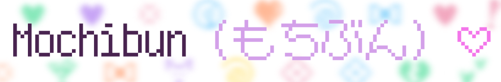

A lightweight pastel Android launcher built from scratch for physical keypad and D-pad flip phones ♡<br/>
Lovingly tuned for the **ALT Mive Style Folder (AT-M120)**.

[Download Latest APK](https://github.com/smolstinkyprincess/Mochibun/releases/latest) • [Setup](#-downloads--setup) • [Screenshots](#-gallery--showcase-) • [Keypad Guide](#️-physical-key-map)

[](https://liberapay.com/crinklecodone/)
[](https://github.com/smolstinkyprincess/Mochibun/actions/workflows/ci.yml)
[](https://github.com/smolstinkyprincess/Mochibun/actions/workflows/fdroid-repo.yml)
[](https://crinklecod.one/Mochibun/fdroid/repo)

</div>

---

> ♡ **Quick heads up:** No root needed! As of **v2.1.0**, Mochibun runs happily on a stock, unrooted flip phone: launcher, T9 search, Keitai keyboard, Kaomoji wheel, themes, and even the side-key mouse pointer (through an optional Accessibility helper). Root-only settings stay tucked away until you ask for them. Rooted with Magisk + LSPosed? The extra magic wakes up: pastel SystemUI theming, speedy native taps, key remapping in every app, and the new **Lid LED Studio ✨** for the outer lid lights. Full steps are in [Setup](#-downloads--setup).

---

## ✨ Features

### Everyday
- **Made for real buttons**: Everything works with the d-pad, and a soft pastel glow shows what's selected so you never lose your place.
- **Keitai keyboard**: A system-wide multi-tap & predictive T9 keypad keyboard in a little floating pill. Tap a number to cycle its letters, hold for the digit, tap `*` for mode (`abc` / `T9` / `123`), hold `*` for case, `#` for space. It hops out of the way of what you're typing in.
- **Kaomoji wheel**: Long-press `#` in any app to pop up a wheel of text faces and paste one into your chat `( ˶ˆᗜˆ˵ ) ♡`
- **Widgets & music deck**: A widget page with a Now Playing card that appears when music plays and hides when it stops. Third-party widgets work too.
- **Virtual mouse pointer**: Press the side key (F4) for a little cursor in touch-only apps. Click with the center key, scroll with `2`/`8` and `4`/`6`, and use your own `.png` or `.gif` sprite. No root? Turn on the optional Accessibility helper and it taps and scrolls anyway.
- **Clamshell tricks**: Choose what opens when you flip the phone open (Home, Resume Last App, or Notifications), plus an optional snap sound when you close it. **Flip Reset on Sleep** tidies up (back to Home, menus closed, cursor hidden) whenever the screen goes dark, so unrooted phones get a clean flip-shut too.
- **Soft-key navigation**: Recents and Back act as little LSK / RSK soft keys on Home and in the drawer, and you can switch that off in *Settings > Virtual Cursor*.
- **Mochibunny pocket pet 🐰**: The little bunny on Home is yours to look after now! Press Center on her (or tap her) to pop open a tiny **Feed / Pet / Chat** pill, or use `1` / `2` / `3` on the keypad. Treats show up on their own: walk a little (1 per 1,000 steps, if your phone has a step counter), clear your notifications, or plug in your charger. She gets peckish, sulky, and sleepy as the day goes on, and her little speech bubbles change with her mood. No guilt, no game over, just a cozy loaf ♡
- **Offline & private**: No internet permission, no camera permission, no telemetry (verified on the merged release manifest in CI). See [`PRIVACY.md`](PRIVACY.md) for every declared permission and optional helper.

### Make it yours
- **5 pastel themes**: *Sakura Dream*, *Lavender Mist*, *Minty Matcha*, *Milky Peach*, and *Midnight Mochi* for night owls 🌙. Switch live, or write your own in simple YAML.
- **7+ keypad sound profiles**: Generated on-device so the app stays tiny—*Kawaii Pop*, *Retro Keitai*, *8-Bit Chiptune*, *Cyber Pager*, *Tactile Thock*, *Water Drop*, or *Muted* for library mode—plus custom `.ogg` sound packs loaded from `.mochibundle` themes!
- **Sticker-tray folders & 1-bit keitai icons**: Folders open as a cozy sticker tray sitting atop the clouds with a ribbon bow, scattered charms (or a tidy 3×2 grid) with a gentle tilt nudge, and crisp 1-bit Docomo pixel icons throughout the Settings Hub.
- **All-in-one `.mochibundle` theme packs**: Back up pinned apps, folders, and settings to `.json`, or pack your palette, greeting, custom font (`font.ttf`/`font.otf`), keypad sound pack (`sounds/<cue>.ogg`), wallpaper, custom cursor, 9-slice card border, and 8-row `mascot_atlas.png` + dialogue into a `.mochibundle` file to swap with friends.
- **Icon pack support**: Works with Nova, Apex, and ADW icon packs.

### Root / LSPosed extras
- **Key remapping**: Remap extra physical buttons right from the visual AT-M120 keypad diagram in the refreshed **Keypad Remapper**—works in every app with no accessibility service running.
- **System-wide font sync**: Optionally apply a `.mochibundle`'s custom font across the whole phone through a safe Magisk overlay module (*Settings > Appearance > Typography & Borders*).
- **QuickSwitch recents**: Make Mochibun's keypad recents switcher your system Recents provider.
- **In-place toggles**: Wi-Fi and Bluetooth flip right inside the Quick Settings card (without root, they open the Android settings panel instead).
- **Speedy root clicks**: The cursor taps through a tiny native helper, even on screens that ignore normal taps.
- **Media volume lock**: The volume rocker always changes *media* volume, even in Silent Mode.
- **Pastel SystemUI**: Your palette also colors Quick Settings, the volume dialog, notification cards, and the status and nav bars.
- **Lid LED pulses**: Notification shimmers and a charging glow on the outer lid lights, in the color you pick.
- **Lid LED Studio ✨**: Draw your own little light shows for the five windows on the outer lid! Build them step by step (500 ms per step, up to 16 steps) with 7 vivid keitai swatches, preview them on screen, then hit **Test Lid ♡** to watch them play for real. Pick one animation for **notifications** and another for **charging**: each loops for about a minute, then rests on its last frame. Comes with 5 cute presets (*Sakura Chase ♡*, *Keitai Rainbow*, *Mint Heartbeat*, *Berry Sparkle*, *Lemon Ping-Pong*), and you can share them as `.mochibunled` files  to trade with friends. Find it in *Settings > Behavior > Clamshell & Lid > Lid LED Studio*.

---

## 📸 Gallery & Showcase ♡

<div align="center">

| 🌸 Home Screen | 🍡 App Drawer | 🗂️ Recents | 🎀 Folders |
| :---: | :---: | :---: | :---: |
| 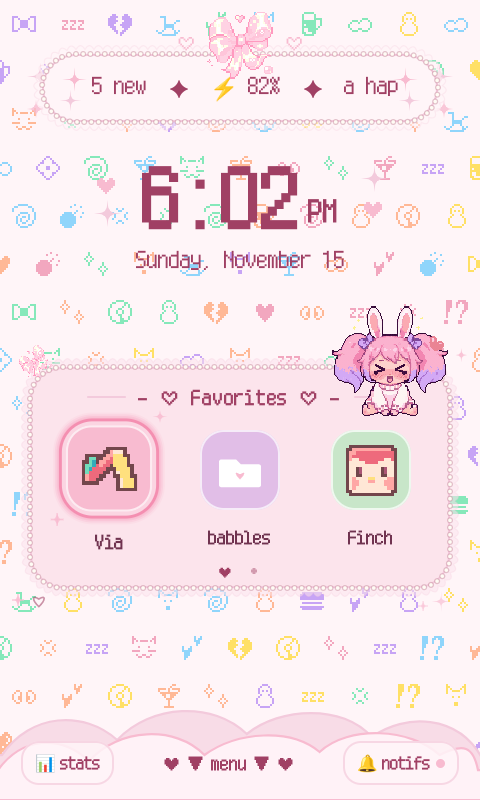 | 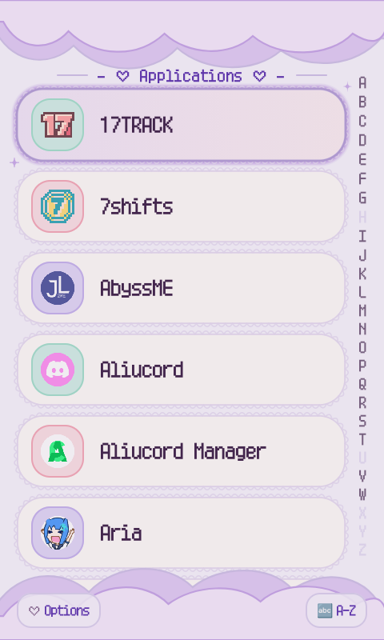 | 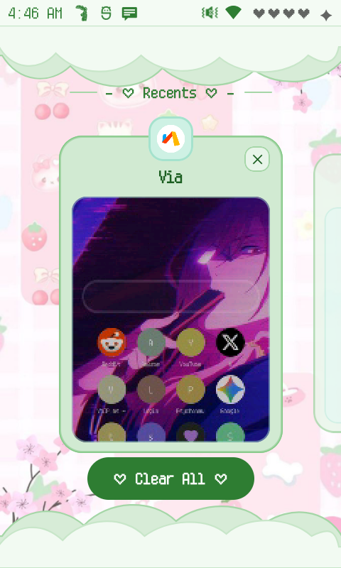 | 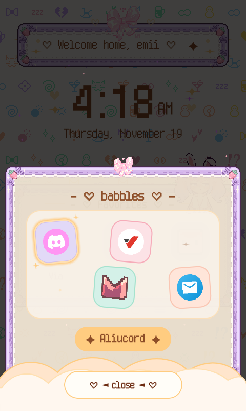 |

| 📊 System Stats | 💌 Notifications | 🌸 Kaomoji Wheel | ⚙️ Settings Hub |
| :---: | :---: | :---: | :---: |
| 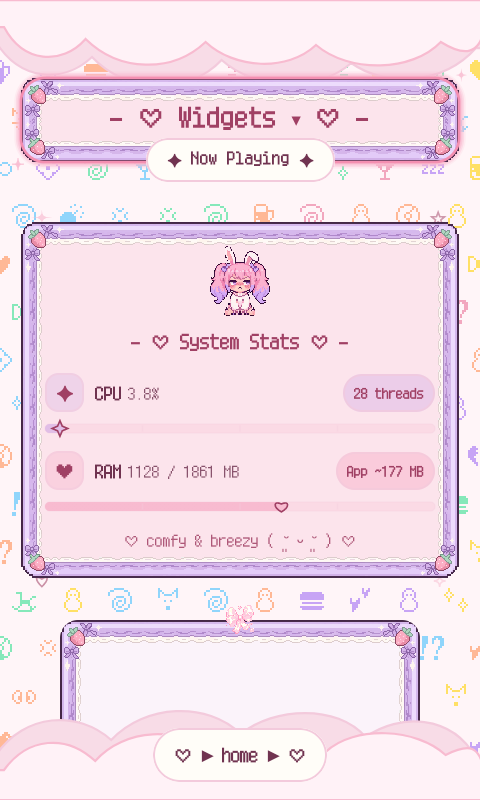 | 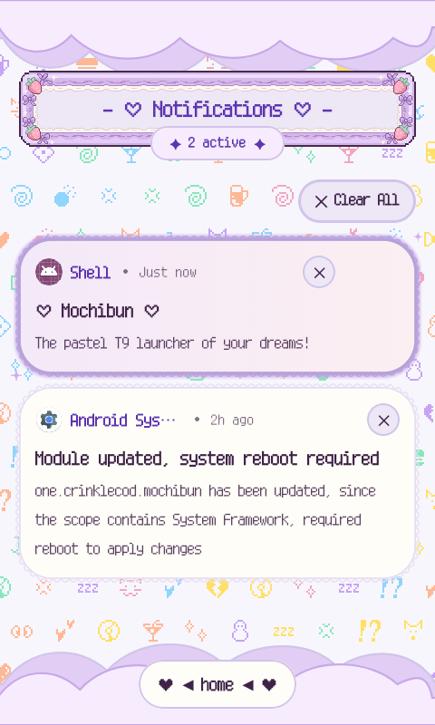 | 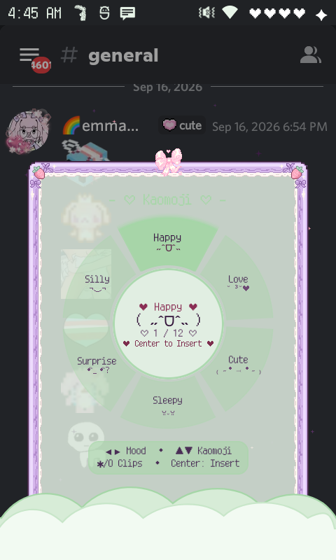 | 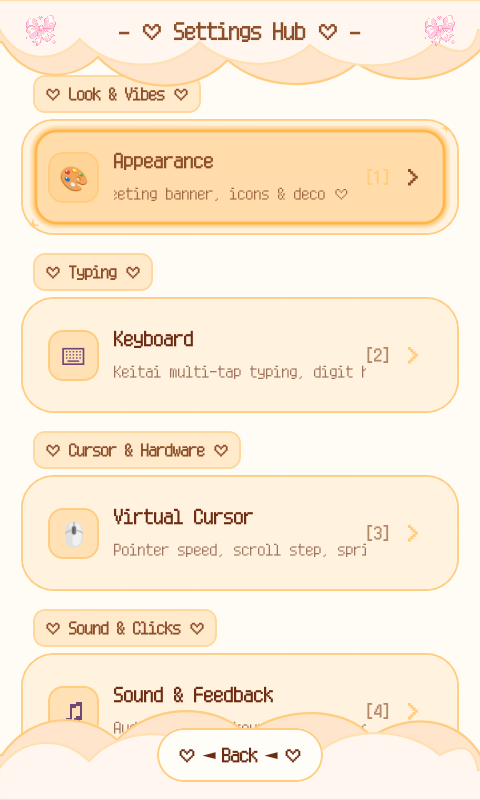 |

| ✨ Lid LED Studio | 💡 Step Maker | 🎨 Pastel SystemUI |
| :---: | :---: | :---: |
| 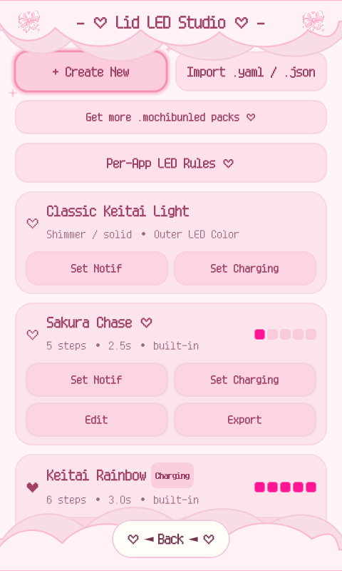 | 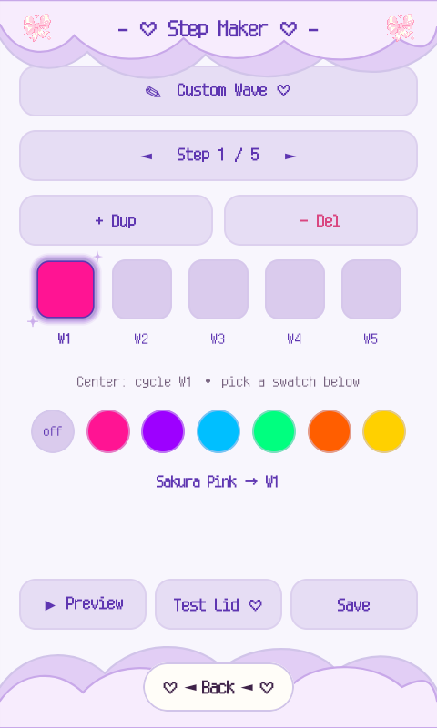 | 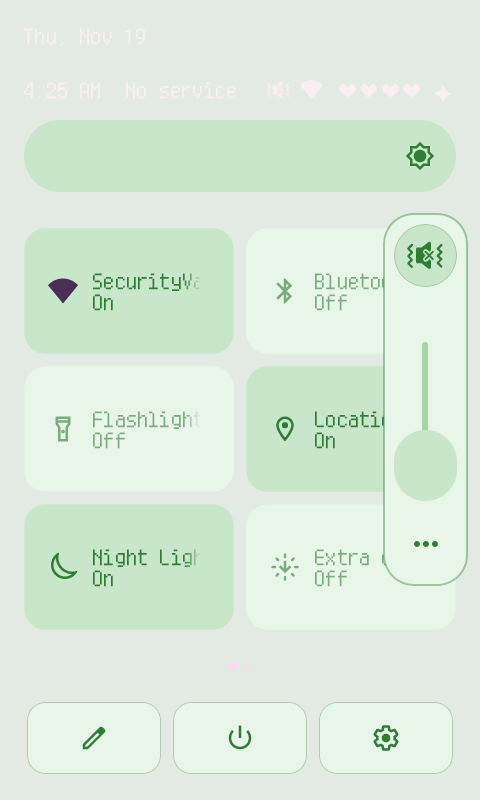 |

</div>

---

## ⌨️ Physical Key Map

<div align="center">
  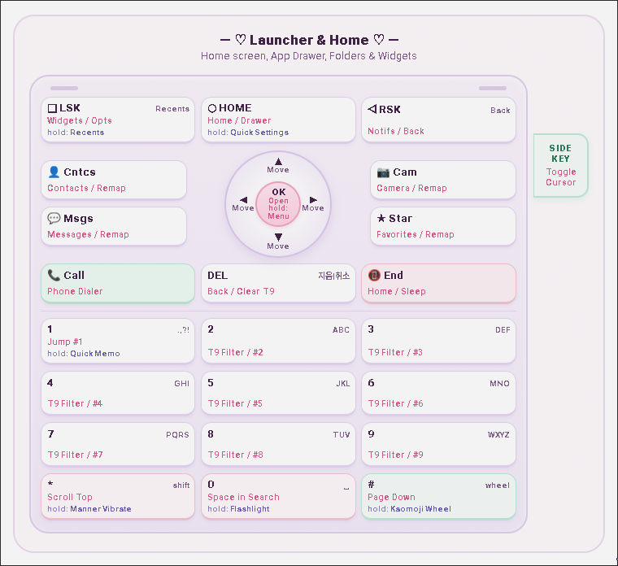
  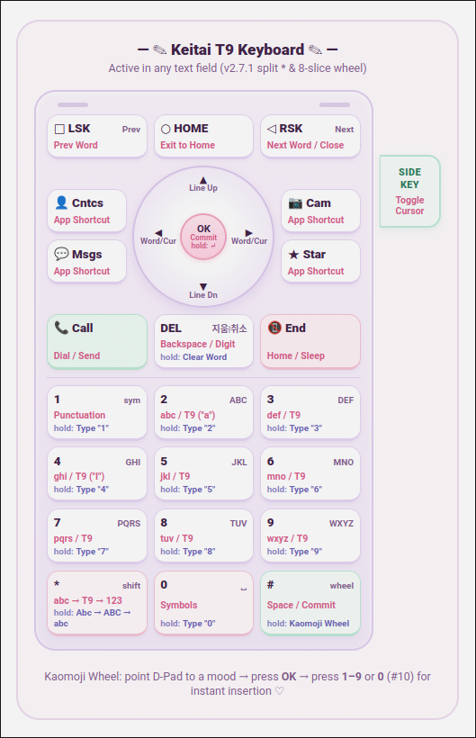
</div>

> 🗝️ Without root, the side key and cursor keys work everywhere through the optional [Accessibility helper](#-standard-non-root-setup). Remapping extra buttons in every app comes from the [LSPosed module](#-lsposed-module-hardware-keys--cursor).
>
> 💡 **Interactive Key Guide**: Open **Key Guide** under *Settings > Keyboard* (or **Keypad Remapper** under *Settings > Virtual Cursor*) for a visual AT-M120 flip-phone keypad diagram that lights up as you press real keys across the **Launcher**, **Typing**, and **Remap** tabs!

---

## 🔤 Mochibun Keitai Keyboard

Mochibun ships its own keypad keyboard, so typing feels like a real 2000s keitai—with **offline T9 predictive text** or classic multi-tap—in any app on the phone (see the **Keitai T9 Keyboard** diagram above for every key's tap and hold action):

- The keyboard is a little floating pill, so it never squishes the app behind it. When you're not pressing keys, it shrinks down to a tiny `abc` / `Abc` / `ABC` / `T9` / `T9↑` / `T9🔒` / `123` badge.
- **Offline T9 prediction & learned words:** Tap `*` to switch into `T9` mode using the bundled 30k+ English dictionary (contractions included), and hold `*` at any time to cycle `Abc` → `ABC` → `abc` (even mid-word in T9). Words you commit twice automatically rank higher for you, stored strictly offline on your device. Want another language or custom wordlist? Drop any `.tsv` or `.txt` wordlist into `Android/data/one.crinklecod.mochibun/files/dictionaries` and switch under **Settings > Keyboard > Predictive Text > T9 Dictionary**.
- **It dodges your text box.** If the box you're typing in is down at the bottom of the screen (hi, Discord), the pill hops to the top so you can see your words, then hops back down when the coast is clear. Some apps don't tell Android where the cursor is, and in those the pill just stays at the bottom.
- **It fades when you pause.** After a moment with no key presses the pill turns soft and see-through, then comes back to full strength on your next press.
- A pending multi-tap letter commits on its own after a short pause (**Auto-Commit Delay**: 0.7 s by default, adjustable from 0.3 to 1.5 s), while T9 words wait for Space / Center / navigation so you have time to pick the right word.
- Sentences auto-capitalize in both multi-tap and T9.
- Number, phone, and date fields get plain digits, so dialing works the way you'd expect.
- Works in terminals like **Termux** too. Delete and Enter go straight to the terminal as plain keys.
- Tune **Predictive Text (T9)**, **T9 Dictionary**, and **Learn New Words** / **Clear Learned Words** (new words you type appear in T9 after typing them twice) under **Settings > Keyboard > Predictive Text**, and tune **hold delay** (250–800 ms), **letter auto-commit**, and **hold vibration** under **Settings > Keyboard**. All of them (plus your learned words) are saved in your `.json` backups.

**Setup**: Open **Settings > Keyboard** and follow the steps there, or go to *Settings > System > Languages & input > On-screen keyboard* and enable **Mochibun Keitai IME**.

---

## 🌸 Kaomoji Wheel (`#` Long-Press)

Never wrestle with tiny touch keyboards just to send a cute face:

1. **Pop it open**: Hold **`#`** for a split second, anywhere on the phone, even mid-chat in another app.
2. **Pick a mood (Stage 1)**: Point the **D-Pad** toward North / East / South / West (*Happy*, *Love*, *Sleepy*, *Shock*)—or tap two perpendicular arrows quickly to tilt onto the diagonal moods (*Hype*, *Cute*, *Shy*, *Silly*)—then press **Center** (or the same arrow again) to lock it in, or press **`1`–`8`** to jump straight into a slice.
3. **Pick a face (Stage 2)**: Press **`1`–`9`** or **`0`** (`#10`) for an instant one-tap pick, or browse with **left / right arrows** and confirm with **Center** (`Up` / **Back** returns to moods).
4. **Clips & Snippets**: Tap **`*`** in either stage to flip to your recent clipboard history & pinned **Quick Snippets**.
5. **Close**: Tap **Back** (in Stage 1), your side key, or **`#`** again to tuck it away.

---

## 🎨 Themes & Custom Styling

> 🎀 **Looking for ready-made themes, custom pocket-pet mascots, or Lid LED animations?**  
> Browse and download `.mochibundle` and `.mochibunled` packs from the **[Mochibun Community Gallery](https://crinklecod.one/Mochibun/community/)** — tap any downloaded file on your phone to preview and apply in one click ♡

### 🎀 Shareable Theme Packs (`.mochibundle`)
Export or import an all-in-one `.mochibundle` bundle in **Settings > Appearance > Theme Packs** to pack your colors, typography (`font.ttf` / `font.otf`, ≤ 4 MB), keypad sound pack (`sounds/<cue>.ogg`, ≤ 256 KB per cue), greeting text, wallpaper, custom mouse cursor (`.gif`/`.png`), 9-slice card border, and 8-row `mascot_atlas.png` + dialogue. Opening a `.mochibundle` (or legacy `.mochibun`) on your phone shows a live swatch and asset preview before applying in one tap—and rooted users can also sync the pack's font system-wide via Magisk.

### 🐰 Custom Mascots, YAML Themes & Lid Animations
- **Custom Mochibunny (`mascot_atlas.png`)**: Swap the pocket pet with an 8-row pixel-art sprite sheet in *Settings > Appearance > Wallpaper & Deco > Custom Mascot*, plus optional mood dialogue pools inside `.mochibundle` packs.
- **YAML Themes (`kaml`)**: Drop `.yaml` palettes into `/sdcard/Android/data/one.crinklecod.mochibun/files/themes/`.
- **Lid LED Animations (`.mochibunled`)**: Share and import 5-window light shows into **Lid LED Studio**, or create and edit full `.mochibundle` theme packs—including custom fonts, keypad sound packs, 9-slice borders, and 8-row mascots—right in your browser with the **[Mascot & Bundle Workshop](https://crinklecod.one/Mochibun/community/workshop.html)**.

See **[Theme, Mascot & Lid LED Formats](docs/theming_formats.md)** for full YAML schemas, sprite sheet dimensions, and `.mochibundle` layout details.

### 📦 Full Backups (`.json`)
Head to **Settings > Backup & Restore** to save your pinned favorites, folders, hidden apps, key remaps, cursor tweaks, and mochibunny's stats to a simple `.json` file. Restoring shows a preview summary first and reloads everything instantly, no reboot needed.

## 📱 Hardware & Specs

My daily driver, and the phone every pixel of Mochibun is fitted to:

| Specification | Target Details |
| :--- | :--- |
| **Target Device** | ALT Mive Style Folder (AT-M120) |
| **Android Version** | Android 12 (API 31) on the AT-M120; installs on Android 8.1+ (API 27) |
| **Processor / ABI** | MediaTek MT6761 (`armeabi-v7a` 32-bit ARM) |
| **Display** | 480 × 800 |
| **RAM** | ~1.8 GB |
| **Network** | 100% offline: no internet or camera permissions ([`PRIVACY.md`](PRIVACY.md)) |

> **Other flip phones**: Since v2.2.1 Mochibun installs on Android 8.1+ (`minSdk 27`) devices that support `armeabi-v7a` (32-bit or dual-ABI 64-bit ARM), e.g. Kyocera DIGNO Keitai 3 (`902KC` / `903KC`) or `KYF42`. Note that `arm64`-only phones and x86 emulators cannot install the `armeabi-v7a` APK. These phones are community-untested: AT-M120-only extras (outer lid LEDs, pastel SystemUI hooks) hide or quietly do nothing, and 1 GB RAM phones get a smaller image cache with still GIFs. Pick a **Cursor Toggle Key** in *Settings > Virtual Cursor* if your phone has no F4 side key.

> **Measured Performance on AT-M120 (`v2.4.2` release APK)**:
> Heavy GPU runtime blurs (`Modifier.blur()`) are strictly avoided, opaque icons compact to `RGB_565`, and background/IME work pauses when hidden. Measured on an actual **ALT Mive Style Folder (AT-M120)** (`1.82 GiB` RAM, Android 12, `MochibunImeService` active as default keyboard):
> - **Release APK size:** `3.17 MiB` (`3,328,228 B`)
> - **Home idle memory:** `~107–109 MiB` Total PSS (`~61 MiB` Private Dirty; settles to `~83 MiB` PSS after clean pagecache eviction)
> - **Post-stress peak memory:** `~93–106 MiB` Total PSS across App Drawer scrolling, sort cycling, T9 search, pager swipes, Settings, and IME Kaomoji Wheel; drops by `~6.8 MiB` immediately on `TRIM_MEMORY_RUNNING_CRITICAL`
> - **Frame & GPU timings:** `0.00%` jank at Home idle (`10 ms` p50 / `14 ms` p95 CPU; `3 ms` p50 / `4 ms` p95 GPU, `0` missed vsyncs); `5 ms` p95 (`7 ms` p99) GPU time under rapid App Drawer flings (`93 ms` p95 CPU); `899 ms` median warm activity launch (`856–939 ms` over 3 trials)

---

## 📥 Downloads & Setup

| Source | Details | Link |
| :--- | :--- | :--- |
| **Website** | Showcase & Guides | [crinklecod.one/Mochibun](https://crinklecod.one/Mochibun) |
| **Community Packs** | Themes, Custom Mascots & Lid LEDs | [Browse & Download ♡](https://crinklecod.one/Mochibun/community/) |
| **GitHub Releases** | Direct APK download | [Download Latest APK](https://github.com/smolstinkyprincess/Mochibun/releases/latest) |
| **Obtainium** | One-click update tracking | [](https://apps.obtainium.imranr.dev/redirect?r=obtainium://app/%7B%22id%22%3A%22one.crinklecod.mochibun%22%2C%22url%22%3A%22https%3A%2F%2Fgithub.com%2Fsmolstinkyprincess%2FMochibun%22%2C%22author%22%3A%22smolstinkyprincess%22%2C%22name%22%3A%22Mochibun%22%7D) |

> 💡 **Using an ALT Mive Style Folder (AT-M120)?**
> Mochibun works great right out of the box, no root required! (˶ᵔ ᵕ ᵔ˶) Start with the [Standard (Non-Root) Setup](#-standard-non-root-setup) below. Want the extra perks later? Hop to [Optional Root & LSPosed Perks](#-optional-root--lsposed-perks) ✨

### 🌷 Standard (Non-Root) Setup

This is the default, and it's how most flip phones will run Mochibun. Root-only settings are hidden so the Settings Hub stays tidy. Open **Settings > Permissions & Root** and walk the little checklist; each row says **✓ Active** or **Tap to Enable** and jumps straight to the right Android page:

1. **Default Home App**: *Settings > Apps > Default Apps > Home app*, then pick Mochibun.
2. **Display Over Other Apps** (`SYSTEM_ALERT_WINDOW`): lets the virtual mouse pointer float on top of every app.
3. **Mochibun Accessibility Service (Optional)**: *Settings > Accessibility > Mochibun Cursor & Keys*. This lets the cursor tap and scroll in touch-only apps, makes the side key (F4) toggle the cursor anywhere, and lets keypad shortcuts open Recents, notifications, and Quick Settings, all without root. [`accessibility_service_config.xml`](app/src/main/res/xml/accessibility_service_config.xml) explicitly sets `android:canRetrieveWindowContent="false"` and requests no accessibility event types, so it never reads what's on your screen, and it steps aside automatically if the LSPosed hook is running.
4. **Notification Access (Optional)**: *Settings > Apps > Special app access > Notification access*. Powers the Now Playing music card and the notifications page.

The checklist also has rows for the **Mochibun Keitai IME** (see [Mochibun Keitai Keyboard](#-mochibun-keitai-keyboard)) and the virtual cursor, which shows whether it's ready to go. The cursor only runs (with its little status-bar notification) while it's actually on screen, so your notification shade stays quiet the rest of the time.

> 🌙 **Flip Reset on Sleep**: Without root, Android can't see the flip's hall sensor, so Mochibun treats "screen off" as "flip shut": it closes menus and the drawer, hides the cursor, and puts focus back on Home. It's on by default for unrooted phones; toggle it in *Settings > Behavior > Clamshell & Lid*.

### 🔮 Optional Root & LSPosed Perks

Rooted with Magisk and LSPosed? Flip on **Show Root Options** at the bottom of *Settings > Permissions & Root* (it starts on automatically when Mochibun spots `su`). That unlocks **Magisk Root & LSPosed** (*Settings > Permissions & Root > Magisk Root & LSPosed*), system-wide key remapping without Accessibility, QuickSwitch recents, in-place Wi-Fi/Bluetooth toggles, outer lid LED alerts with a charging LED and custom color plus the Lid LED Studio and real hall-sensor lid detection (*Settings > Behavior > Clamshell & Lid*), system-wide font sync (*Settings > Appearance > Typography & Borders*), and pastel SystemUI theming. The **[AT-M120 Root, Magisk & Tuning Guide](docs/m120_root_setup.md)** covers bootloader, Magisk, and microG.

> **Boot animation bonus 🎀**: Got root now? Grab the optional `mochibun-bootanimation.zip` from [Releases](https://github.com/smolstinkyprincess/Mochibun/releases/latest) for a matching pastel boot screen!

### 🧩 LSPosed Module (Hardware Keys & Cursor)

Mochibun is one APK that's both the launcher *and* an LSPosed module, so there's nothing extra to download. The module hooks into the system (`system_server` and SystemUI) so your physical keys, key remaps, and Media Volume Lock work in every app, and your palette can paint SystemUI, all without the Accessibility helper. The mouse pointer itself floats on top as a little foreground overlay service.

1. **Root with Magisk and install LSPosed (or Vector with Zygisk Next)** (the Zygisk version). The [AT-M120 guide](docs/m120_root_setup.md) covers the Magisk side.
2. **Install Mochibun**, then open LSPosed/Vector and enable the **Mochibun** module.
3. **Tick both scopes** for the module: *System Framework* (`android`) and *System UI* (`com.android.systemui`).
4. **Reboot** so the hook loads.

No LSPosed? No problem! The launcher, drawer, T9 search, widgets, themes, backups, the Keitai Keyboard, and the virtual cursor (via the Accessibility helper) all work without it. You'll just miss remapping extra buttons, Media Volume Lock, and SystemUI theming.

### 🗝️ Root Extras Checklist

1. **Superuser Access**: Granting Mochibun superuser access in Magisk unlocks fast native touch injection (handy when a screen blocks normal taps, like permission dialogs), root Quick Settings toggles, exterior lid LED alerts, and hall-sensor lid detection. The LSPosed hook doesn't need it.
2. **QuickSwitch (Optional)**: If you use QuickSwitch for hardware multitasking, set Mochibun as your provider:
   ```bash
   su -c "/data/adb/modules/quickswitch/quickswitch --ch=one.crinklecod.mochibun"
   ```

---

## 🛠️ Building from Source

**Requirements:** **JDK 21**, **Android SDK 37** (`compileSdk 37`), and **Android NDK + CMake** (3.18.1+, used for the native `evinject` and `lidled` helpers).

```bash
git clone https://github.com/smolstinkyprincess/Mochibun.git
cd Mochibun
./gradlew assembleDebug
```

The debug APK (signed with the default debug key) will be at `app/build/outputs/apk/debug/app-debug.apk`.

> **Building a release APK:** `./gradlew assembleRelease` produces an **unsigned** `app/build/outputs/apk/release/app-release-unsigned.apk` unless you provide a `keystore.properties` file in the repo root (`RELEASE_STORE_FILE`, `RELEASE_STORE_PASSWORD`, `RELEASE_KEY_ALIAS`, `RELEASE_KEY_PASSWORD`)—see [`app/build.gradle.kts`](app/build.gradle.kts#L38-L66). With `keystore.properties` configured, Gradle outputs the signed `app/build/outputs/apk/release/app-release.apk`.

---

## 🌸 Sweet Credits & Thanks ♡

Mochibun stays tiny, breezy, and cute thanks to these awesome projects:

- **[Coil](https://github.com/coil-kt/coil)**: Keeps animated `.gif` and `.png` cursors (and Mochibunny!) dancing smoothly without chewing up precious RAM! (˶ᵔ ᵕ ᵔ˶)
- **[libsu](https://github.com/topjohnwu/libsu)** by [@topjohnwu](https://github.com/topjohnwu): Handles fast background root clicks and clean recents switching. (•̀ᴗ•́)و
- **[kaml](https://github.com/charleskorn/kaml)**: Friendly, human-readable YAML parsing for custom themes and lid light animations. ♡
- **[MaruMinya (マルミーニャ)](https://www.freejapanesefont.com/maruminya-cute-free-font/)**: The darling rounded dot-matrix font powering Mochibun's nostalgic keitai typography! ♡
- **[og-emoji-font](https://github.com/nicoleexpress/og-emoji-font)**: Preserves the iconic 12×12 NTT Docomo i-mode pixel pictograms that give Mochibun's menus and settings that genuine mid-2000s keitai charm! ♡
- **[FrequencyWords](https://github.com/hermitdave/FrequencyWords)** ([CC BY-SA 4.0](https://creativecommons.org/licenses/by-sa/4.0/)) & **[SCOWL](http://wordlist.sourceforge.net/)**: Powers Mochibun's offline predictive T9 English wordlist (`en.tsv`). ♡
---

## 📄 License

Distributed under the [Apache 2.0 License](LICENSE). Feel free to fork, customize, and adapt it for your own physical-key Android setups!

---

## ♡ Support

Mochibun is free, offline, and open-source forever with zero paywalls or subscriptions. If it makes your flip phone cuter or easier to use and you'd like to buy me boba or a snack, you can leave a tip on [Liberapay](https://liberapay.com/crinklecodone/) 🌸✨

---

<div align="center">

*Mochibun was created with love, eepy late-night tinkering, and a little help from AI tools for code scaffolding and debugging.* ♡

</div>
