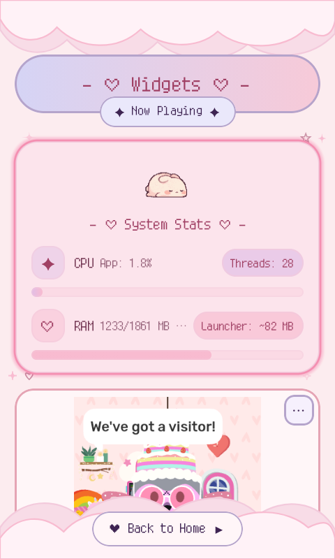
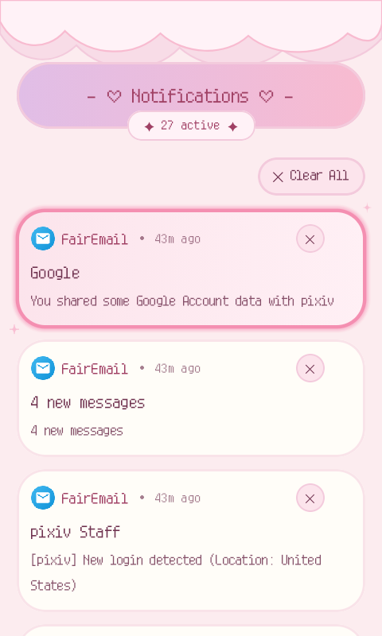
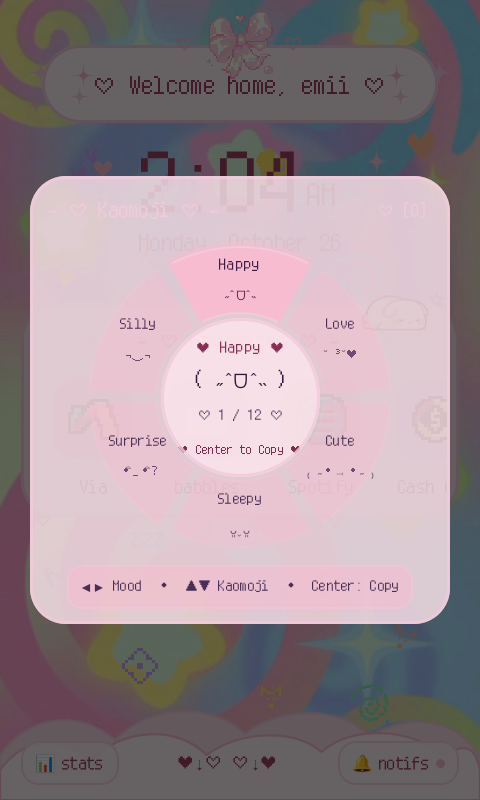

A lightweight, pastel Android launcher built with Jetpack Compose and Material 3, tailored specifically for the **ALT Mive Style Folder (AT-M120)**.

---

## ✨ Features

- **Keypad First**: Built from the ground up for physical buttons. Use your directional pad to move through every card, drawer, and menu.

- **Made for Small Screens**: Designed specifically for 480 × 800 flip phone displays—no awkward overlapping cards or text running off the screen.

- **Virtual Mouse Cursor**: A built-in mouse pointer you can turn on and off anytime using your side button. Great for apps that demand touchscreen taps. Supports animated `.gif` or `.png` cursors, adjustable speeds, and vertical scrolling(using 2 and 8 on the keypad).

- **T9 App Search**: Start typing on your number pad to filter and launch apps right inside the app drawer.

- **Kaomoji Radial Wheel**: Long-press the physical **`#` (Pound)** key(remappable) anywhere on the Home Screen or App Drawer to pop up an authentic radial selection wheel! Browse 6 categorized moods (*Happy*, *Love*, *Cute*, *Sleepy*, *Surprised*, and *Silly*) using your D-Pad or numeric keys `1`–`6`, then press **Center/Enter** to copy your chosen kaomoji straight to your clipboard with sweet haptic feedback `( ˶ˆᗜˆ˵ ) ♡`.

- **Procedural Keitai Sound Themes**: Authentic tactile audio feedback synthesized procedurally in memory on first boot—zero heavy audio assets inflating the APK! Choose your favorite sound profile in settings: *Kawaii Pop*, *Retro Keitai* (classic 2000s flip phone click!), *8-Bit Chiptune*, *Cyber Pager*, *Tactile Thock*, *Water Drop*, or silent mode.

- **Hardware Key Remapping(root required)**: Remap function buttons and other hardware keys to simple actions or launch an app.

- **Widgets Page**: A dedicated widget screen featuring a dynamic Now Playing media card that automatically appears during active playback and tucks away when audio stops, alongside support for your own Android widgets.

- **Theme Studio & YAML Formatting**: Pick from 4 built-in pastel themes (*Sakura Dream*, *Lavender Mist*, *Minty Matcha*, and *Milky Peach*) with instant live previews, or design your own clean, human-readable YAML themes powered by `kaml`.

- **Backup, Restore & Setup Sharing**: Full disaster-recovery system backups (`.json`) alongside lightweight, shareable theme packs (`.mochibun` bundles) to swap aesthetic setups with the flip-phone community.

- **Icon Pack Support**: Compatible with standard icon packs (Nova, Apex, ADW) with smart caching so it stays light on memory.

---

## 📸 Gallery & Showcase ♡

<div align="center">

| 🌸 Home Screen | 🎀 Folders | 🗂️ Recents |
| :---: | :---: | :---: |
|  |  |  |

| 🎵 Widgets & Music | 💌 Notifications | 🌸 Kaomoji Wheel |
| :---: | :---: | :---: |
|  |  |  |

</div>

## ⌨️ Physical Key Map

| Button | Short Press | Long Press (Hold ~400ms) |
| :--- | :--- | :--- |
| **D-Pad (Arrows)** | Navigate cards, app drawer & wheel sectors | Continuous fast scroll |
| **Center / Enter** | Launch app, select item, or activate | Open context menu (pin, edit icon, info) |
| **`#` (Pound Key)** | Open launcher menu & theme switcher | **Open Kaomoji Radial Wheel 🌸** |
| **`*` (Star Key)** | Open context actions | Toggle ringer mode (Normal / Vibrate) |
| **`0` Key** | Jump to page / input | **Toggle Flashlight On / Off 🔦** |
| **`2`–`9` Keys** | T9 app search (drawer) / Page switch | **One-Touch Speed Dial Launch** |
| **Side Button (F4)** | Toggle virtual mouse pointer on / off | Dismiss active modal or overlay |
| **Call Key** | Open phone dialer | — |
| **Back Button** | Close dialogs, folders, or drawer & return Home | — |

---
## 🌸 Kaomoji Radial Wheel (`#` Long-Press)

Need to drop a cute face in your chat without wrestling with an awkward software keyboard? Mochibun includes an on-device Kaomoji radial menu tailored specifically for physical keypad navigation:

1. **Invoke**: Hold the **`#`** key on your keypad for ~400ms from anywhere on the home screen or app drawer.
2. **Browse Moods**: Tap **D-Pad Left / Right** (or press keys **`1`–`6`**) to rotate through the mood segments (*Happy*, *Love*, *Cute*, *Sleepy*, *Surprised*, and *Silly*).
3. **Pick Expression**: Tap **D-Pad Up / Down** to cycle through the expressions in the center hub.
4. **Copy & Share**: Hit **Center / Enter** to copy the kaomoji to your clipboard and close the wheel with a bubbly sound effect.
5. **Dismiss**: Press **Back**, **F4**, or tap **`#`** again to close without copying.

---


## 🎨 Themes, Backups & Setup Sharing

Mochibun makes it easy to preserve your layout or share aesthetic presets with the dumbphone community:

### 📦 Full System Backup & Restore (`.json`)
Located in **Settings > Backup & Restore**, this generates a timestamped `.json` snapshot using Android's Storage Access Framework:
- **What's Saved**: Pinned favorites, folders and custom icons, hidden bloatware, hardware key remaps, T9 settings, and virtual cursor physics.
- **Hot-Reloading**: Restoring or resetting applies immediately across your home screen and drawer without restarting the app or killing your session.

### 🎀 Shareable Theme Bundles (`.mochibun`)
Want to share your look on Reddit or Discord without exposing private app lists or shortcuts? 
- Exports an archive containing your color palette, greeting text, custom cursor (`.gif`/`.png`), and wallpaper.
- **Deep Link Ready**: Tapping any `.mochibun` file from a download or file manager opens a live preview card with color swatches and instant one-click apply.

### 📝 YAML Theme Editing (`kaml`)
Typing JSON on a 480 × 800 flip-phone keyboard is clumsy and prone to bracket errors. Custom community themes use clean, human-readable YAML parsed via `kaml`:

```yaml
# /sdcard/Mochibun/themes/sweet_sakura.yaml
id: "sweet_sakura"
name: "Sweet Sakura ♡"
author: "emii"

palette:
  primary: "#FFB7C5"
  surface: "#FFF0F5"
  cardBorder: "#F3D1DC"
  accentDeep: "#8B3A62"
  selectionGlow: "#FF8DA1"

greeting:
  template: "♡ Welcome home, %s ♡"
  defaultName: "Princess"
  sparkles: true
```

---

## 📱 Hardware & Compatibility

Mochibun is tuned to run smoothly on modest flip phone hardware:

| Specification | Target Details |
| :--- | :--- |
| **Primary Device** | ALT Mive Style Folder AT-M120 |
| **Operating System** | Android 12 (API 31) |
| **Chipset** | MediaTek MT6761 (ARMv7 / 32-bit) |
| **Display** | 480 × 800 portrait |
| **Memory** | ~1.8 GB RAM |

> **Performance Note**: To keep animations smooth and scrolling responsive, Mochibun avoids expensive real-time blur shaders and heavy image buffers. Decorative cloud trims and accents are drawn using lightweight vector paths.

---

### 📥 Install & Updates

| Platform | Status | Link |
| :--- | :--- | :--- |
| **GitHub Releases** | Official / Direct APK | [Download Latest](https://github.com/smolstinkyprincess/Mochibun/releases/latest) |
| **Obtainium** | One-Click Auto-Updates | [](obtainium://app/https%3A%2F%2Fgithub.com%2Fsmolstinkyprincess%2FMochibun) |

### 🗝️ Set Up Permissions

1. **Default Home App**: Go to *Settings > Apps > Default Apps > Home app* and select **Mochibun**.
2. **Media / Notification Access**: Enable notification access for Mochibun in *Settings > Apps > Special app access > Notification access* so the Now Playing widget can display live track info and album art.
3. **Virtual Mouse Cursor**: Turn on **Mochibun Virtual Cursor** in *Settings > Accessibility*. When Android asks, grant the *Display over other apps* (`SYSTEM_ALERT_WINDOW`) permission.
4. **Root Access (Optional)**: If your phone is rooted with Magisk, granting superuser access lets the cursor use faster shell tap fallbacks (`libsu`) and integrates with custom recents providers.
5. **QuickSwitch Integration (Optional)**: If you use QuickSwitch for physical recents/multitasking, set Mochibun as your provider:
   ```bash
   su -c "/data/adb/modules/quickswitch/quickswitch --ch=com.crinklecodone.mochibun"
   ```

---

## 🛠️ Building from Source

Mochibun builds with standard Gradle tooling:

```bash
# Clone the repository
git clone [https://github.com/smolstinkyprincess/Mochibun.git](https://github.com/smolstinkyprincess/Mochibun.git)
cd Mochibun

# Build release APK
./gradlew assembleRelease
```

The compiled APK will be located at `app/build/outputs/apk/release/app-release.apk`.

---

## 🌸 Sweet Credits & Special Thanks ♡

Mochibun stays tiny, breezy, and cute thanks to these wonderful open-source libraries and/or assets:

- **[Coil](https://github.com/coil-kt/coil)** — Keeps our cute animated `.gif` and `.png` cursors(and our adorable mochibunny mascot!!!) dancing smoothly with an ultra-lightweight memory footprint so our flip phone RAM never gets sad! (˶ᵔ ᵕ ᵔ˶)
- **[libsu](https://github.com/topjohnwu/libsu)** by [@topjohnwu](https://github.com/topjohnwu) — A rock-solid, persistent root bridge daemon that powers super-fast privileged clicks and smooth recents task management without dropping a single frame! (•̀ᴗ•́)و
- **[kaml](https://github.com/charleskorn/kaml)** — Brings clean, whitespace-friendly YAML parsing to `kotlinx.serialization` so creating and editing custom themes on a flip phone is sweet and painless! ♡
- **[MaruMinya (マルミーニャ)](https://www.freejapanesefont.com/maruminya-cute-free-font/)** — The darling rounded dot-matrix font powering Mochibun's nostalgic typography! ♡
---

## 🤖 Disclaimer
Just a girl, her flip phone, and a sprinkle of AI magic to make the code cute! 🌸✨📱

## 📄 License

Distributed under the [Apache 2.0 License](LICENSE). Feel free to fork, customize, and adapt it for your own physical-key Android devices!
