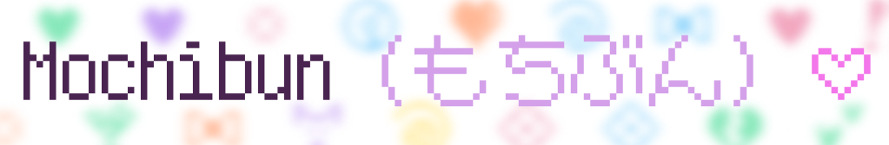
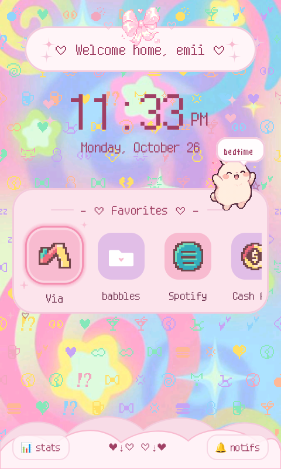
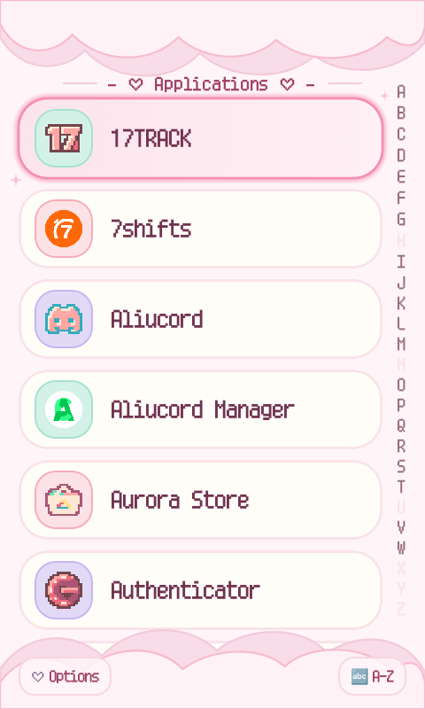
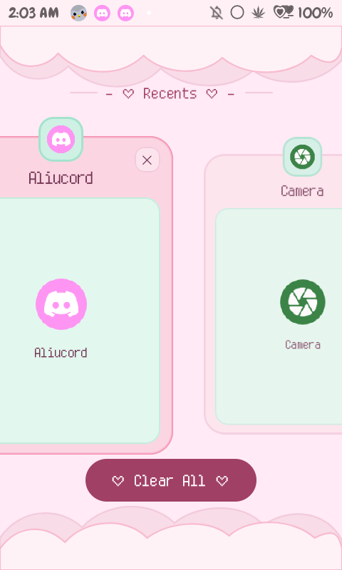
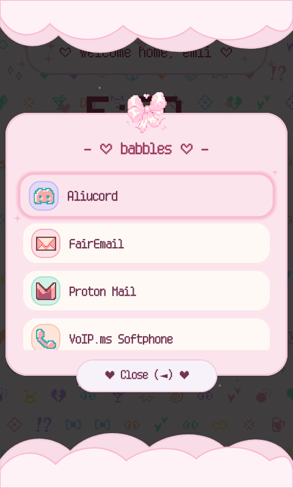
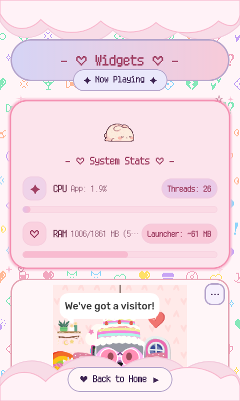
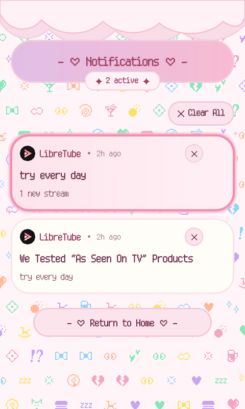
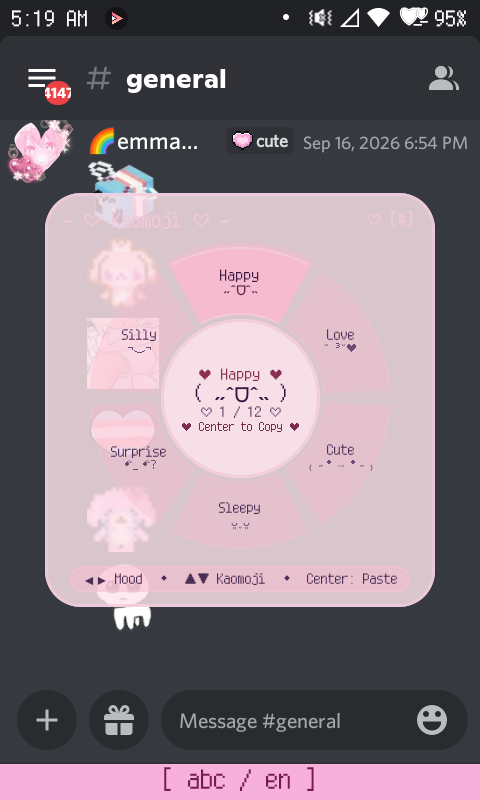
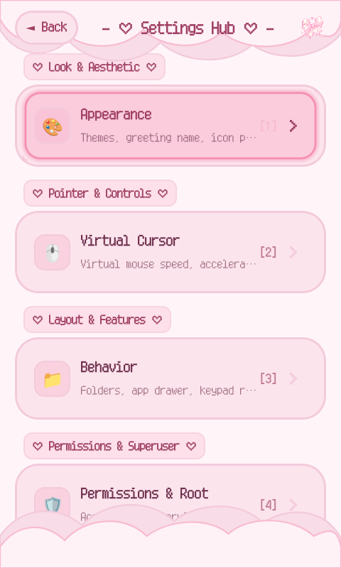

<div align="center">



A cozy, pastel Android launcher made with love for physical keypads and flip phones, tailored especially for the **ALT Mive Style Folder (AT-M120)**.

[Download Latest APK](https://github.com/smolstinkyprincess/Mochibun/releases/latest) • [Screenshots](#-gallery--showcase-) • [Keypad Guide](#️-physical-key-map)

</div>

---

## ✨ Features

- **Built for Real Buttons**: Every card, folder, and menu is mapped for physical D-pad navigation. Focus rings have a soft pastel glow that won't get cut off by card edges.
- **Snug on Small Screens**: Fitted specifically for 480 × 800 flip-phone displays—no squished text or cut-off buttons.
- **Virtual Mouse Cursor**: Toggle an on-screen mouse pointer anytime with your side key for pesky touch-only apps. Supports custom `.png` or animated `.gif` sprites, scroll keys (2 & 8), and adjustable speed.
- **Physical T9 App Search**: Just start typing numbers on the keypad to filter and launch apps in the drawer—no tapping tiny search bars.
- **Kaomoji Radial Wheel**: Hold down **`#`** anywhere to pop up a quick-dial mood wheel. Spin through 6 cozy vibes (*Happy*, *Love*, *Cute*, *Sleepy*, *Surprised*, and *Silly*) with your D-pad or `1`–`6` keys, tap Enter, and copy your favorite faces straight to your clipboard with a cute click `( ˶ˆᗜˆ˵ ) ♡`.
- **Nostalgic Keitai Click Sounds**: Retro tactile sound effects that generate right on your device so the app stays tiny. Choose from fun sound profiles in settings (*Kawaii Pop*, *Retro Keitai* 2000s clicks, *8-Bit Chiptune*, *Cyber Pager*, *Soft Thock*, *Water Drop*, or mute).
- **Key Remapping (Root Optional)**: Remap your extra physical buttons to launch your favorite apps or trigger quick shortcuts.
- **Widgets Page**: A dedicated widget screen featuring a dynamic Now Playing media card that automatically appears during active playback and tucks away when audio stops, alongside support for your own Android widgets.
- **Theme Studio & Simple YAML**: Pick from 4 built-in pastel themes (*Sakura Dream*, *Lavender Mist*, *Minty Matcha*, and *Milky Peach*) with live previews, or write your own theme files in clean, readable YAML.
- **Setup Sharing & Backups**: Export your pinned apps, folders, and settings to a quick `.json` backup, or pack your colors, custom cursor, and wallpaper into a shareable `.mochibun` theme bundle to swap with friends.
- **Icon Pack Support**: Works with standard icon packs (Nova, Apex, ADW) with gentle memory caching to keep things breezy.

---

## 📸 Gallery & Showcase ♡

<div align="center">

| 🌸 Home Screen | 🍡 App Drawer | 🗂️ Recents | 🎀 Folders |
| :---: | :---: | :---: | :---: |
|  |  |  |  |

| 📊 System Stats | 💌 Notifications | 🌸 Kaomoji Wheel | ⚙️ Settings Hub |
| :---: | :---: | :---: | :---: |
|  |  |  |  |

</div>

---

## ⌨️ Physical Key Map

| Button | Click | Hold (~400ms) |
| :--- | :--- | :--- |
| **D-Pad (Arrows)** | Move around cards, drawers & wheel wedges | Fast-scroll |
| **Center / Enter** | Open app, select item, or click | Quick menu (pin, edit icon, app info) |
| **`#` (Pound)** | Open settings & theme switcher | **Open Kaomoji Wheel 🌸** |
| **`*` (Star)** | Context actions | Toggle silent / vibrate |
| **`0`** | Jump to top / input | **Flashlight toggle 🔦** |
| **`2`–`9`** | T9 search (in drawer) | **One-touch speed dial** |
| **Side Button (F4)** | Turn virtual mouse cursor on / off | Dismiss popup / dialog |
| **Call Key** | Phone dialer | — |
| **Back Button** | Close dialogs, folders, or drawer & return Home | — |

---

## 🌸 Kaomoji Wheel (`#` Long-Press)

Never wrestle with tiny touch keyboards just to send a cute face:

1. **Pop it open**: Hold **`#`** for a split second anywhere on the home screen or drawer.
2. **Pick a mood**: Use **D-Pad Left / Right** (or press keys **`1`–`6`**) to spin through *Happy*, *Love*, *Cute*, *Sleepy*, *Surprised*, or *Silly*.
3. **Pick a face**: Use **D-Pad Up / Down** to browse through kaomojis in the middle.
4. **Copy & paste**: Press **Center / Enter** to copy it straight to your clipboard.
5. **Close**: Tap **Back**, your side key, or **`#`** again to tuck it away.

---

## 🎨 Themes & Custom Styling

### 🎀 Shareable Theme Packs (`.mochibun`)
Want to show off your setup on r/flipphones or Discord? Export a `.mochibun` bundle to pack up your colors, greeting text, wallpaper, and custom mouse cursor (`.gif`/`.png`). Opening a `.mochibun` file on your phone shows a live color swatch card and applies in one click!

### 📝 Hand-Crafted YAML Themes (`kaml`)
Writing JSON on a flip-phone keypad is nobody's idea of a good time. Mochibun uses clean, readable YAML for custom themes:

```yaml
# /sdcard/Mochibun/themes/sweet_sakura.yaml
id: "sweet_sakura"
name: "Sweet Sakura ♡"
author: "emii"

palette:
  primary: "#FFB7C5"
  surface: "#FFF0F5"
  cardBorder: "#F3D1DC"
  accentDeep: "#8B3A62"
  selectionGlow: "#FF8DA1"

greeting:
  template: "♡ Welcome home, %s ♡"
  defaultName: "Princess"
  sparkles: true
```

### 📦 Full Backups (`.json`)
Head to **Settings > Backup & Restore** to save your pinned favorites, folders, hidden apps, key remaps, and cursor tweaks to a simple `.json` file. Restoring reloads everything instantly without needing a reboot.

---

## 📱 Hardware & Specs

Mochibun is tuned specifically to run smoothly on modest flip-phone hardware without battery drain:

| Specification | Target Details |
| :--- | :--- |
| **Target Device** | ALT Mive Style Folder (AT-M120) |
| **Android Version** | Android 12 (API 31) |
| **Processor** | MediaTek MT6761 (32-bit ARMv7) |
| **Display** | 480 × 800 portrait |
| **RAM** | ~1.8 GB RAM |

> **Note on Performance**: Mochibun skips heavy GPU blur shaders and giant uncompressed images. Cloud trims and accents are drawn using lightweight vector paths to keep scrolling smooth and snappy!

---

## 📥 Downloads & Setup

| Source | Details | Link |
| :--- | :--- | :--- |
| **GitHub Releases** | Standalone APK | [Download Latest APK](https://github.com/smolstinkyprincess/Mochibun/releases/latest) |
| **Obtainium** | Auto-Updates | [](obtainium://app/https%3A%2F%2Fgithub.com%2Fsmolstinkyprincess%2FMochibun) |

### 🗝️ Quick Permissions Checklist

1. **Default Home**: Set Mochibun as your home app in *Settings > Apps > Default Apps > Home app*.
2. **Now Playing Card**: Enable notification access in *Settings > Apps > Special app access > Notification access* so the media widget can show your currently playing song and album art.
3. **Virtual Mouse Cursor and Key Remapper**: Turn on **Mochibun Virtual Cursor** and **Mochibun Button Remapper** in *Settings > Accessibility*, and allow *Display over other apps* when asked.
4. **Root Access (Optional)**: If you're rooted with Magisk, granting superuser access lets the cursor click through privileged shell taps and hooks into custom recents providers.
5. **QuickSwitch (Optional)**: If you use QuickSwitch for hardware multitasking, set Mochibun as your provider:
   ```bash
   su -c "/data/adb/modules/quickswitch/quickswitch --ch=com.crinklecodone.mochibun"
   ```

---

## 🛠️ Building from Source

```bash
git clone [https://github.com/smolstinkyprincess/Mochibun.git](https://github.com/smolstinkyprincess/Mochibun.git)
cd Mochibun
./gradlew assembleRelease
```

The APK will be waiting for you in `app/build/outputs/apk/release/app-release.apk`!

---

## 🌸 Sweet Credits & Thanks ♡

Mochibun stays tiny, breezy, and cute thanks to these awesome projects:

- **[Coil](https://github.com/coil-kt/coil)** — Keeps animated `.gif` and `.png` cursors (and Mochibunny!) dancing smoothly without chewing up precious RAM! (˶ᵔ ᵕ ᵔ˶)
- **[libsu](https://github.com/topjohnwu/libsu)** by [@topjohnwu](https://github.com/topjohnwu) — Handles fast background root clicks and clean recents switching. (•̀ᴗ•́)و
- **[kaml](https://github.com/charleskorn/kaml)** — Friendly, human-readable YAML parsing for custom themes. ♡
- **[MaruMinya (マルミーニャ)](https://www.freejapanesefont.com/maruminya-cute-free-font/)** — The darling rounded dot-matrix font powering Mochibun's nostalgic keitai typography! ♡

---

## 📄 License
Distributed under the [Apache 2.0 License](LICENSE). Feel free to fork, customize, and adapt it for your own physical-key Android setups!

---

*Mochibun was created with love, eepy late-night tinkering, and a little help from AI tools(Gemini/Claude) for code scaffolding and debugging.* ♡
